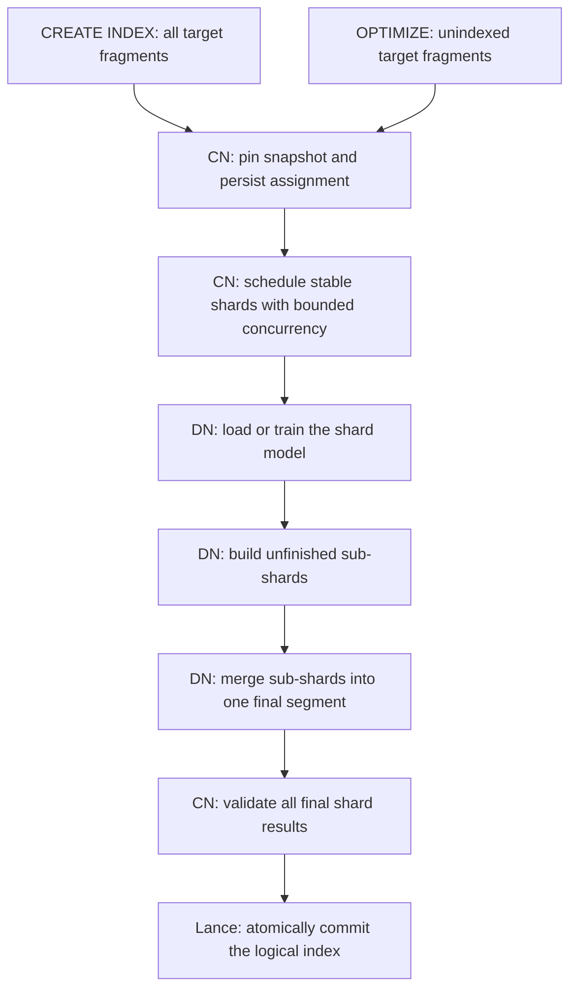

# Aura Integration with Lance: Distributed Indexing Design

**Status:** Design proposal, edited and translated from
[`design.docx`](../design.docx).

**Source baseline:** The original design targets Lance SDK 10.0.0. API names and
several contradictory statements were checked against this repository at commit
`a8618e985`, whose workspace version is 14.0.2. Those checks do not establish that
every described API or behavior is available in 10.0.0. Aura must pin and validate
its actual Lance dependency before implementation.

This document preserves the source's vector, scalar, and full-text indexing
scope. It replaces the embedded architecture diagrams with English descriptions
and diagrams, repairs terminology and examples, and identifies unresolved
technical questions in [Section 10](#10-corrections-and-open-decisions). Proposed
checkpoint fields are identified separately from fields specified by the source.

## 1. Purpose and requirements

Aura needs to build and maintain Lance indices across multiple workers for a
large multimodal image retrieval workload. The motivating workload combines an
existing image collection, continuous ingestion, metadata filtering, text search,
and approximate nearest-neighbor (ANN) search.

| Requirement | Target from the source |
|---|---|
| Initial vector index build | 20 billion vectors in one distributed `CREATE INDEX` operation. |
| Incremental vector indexing | Manually triggered indexing of 4-5 billion additional vectors per day through `ALTER INDEX ... OPTIMIZE`. |
| Eventual collection size | Approximately 100 billion vectors. |
| Vector representation | 1,024 dimensions, described as `float64`; reconcile this with the source's later `float4` restriction before implementation. |
| Image ingestion | Compute and store vectors using a specified embedding model. The source does not define the embedding pipeline. |
| Recovery | Reuse completed work after coordinator node (CN) or data node (DN) failure. |
| Recall | After incremental indexing, meet or exceed the agreed baseline using the same test set and `nprobe` setting. This is an acceptance target, not a guaranteed consequence of local training. |
| Build scalability | Both initial and incremental vector indexing use the same distributed execution path. |
| Stable partitioning | Final vector segment boundaries depend on data size, not the number of available DNs. |

The source also requires global, single-column BTree and inverted full-text
indices, including creation, incremental optimization, deletion, and query use.
Together, these capabilities support queries that filter metadata, match text,
and retrieve similar vectors.

The proposed integration uses the existing CN-DN scheduling framework and adds
no microservices. The source specifies no billing changes.

### 1.1 Scope boundaries

- Vector indexing adopts shard-local models and persistent build checkpoints.
- BTree and full-text creation use distributed segment builds followed by a
  coordinator commit.
- Composite scalar indices, table-partition-local scalar indices, and one
  full-text index spanning multiple columns are outside the source's scope.
- Other scalar index types, including Bitmap, ZoneMap, NGram, and BloomFilter,
  are deferred by this Aura proposal, regardless of their availability in Lance.
- The source motivates distributed query execution but primarily specifies the
  build protocol. Query routing, candidate exchange, and global top-k execution
  need a separate Aura execution contract.

## 2. Terminology and ownership

| Term | Meaning |
|---|---|
| CN | Aura coordinator node. Plans work, schedules DNs, validates outputs, and publishes the index. |
| DN | Aura data node. Opens the pinned dataset version and executes assigned build work. |
| VDN | Aura's virtual data-node resource or concurrency setting. The source uses `query_vdn`; some tests use `fq_query_vdn`. Their exact relationship needs confirmation. |
| OBS | The object storage service used by Aura. Lance dataset files, build artifacts, and checkpoints are stored there. |
| LakeFormation | The catalog or metadata service from which the source design obtains table metadata and the manifest version. |
| Source snapshot | The numeric Lance dataset version selected for a build. |
| Fragment | A Lance dataset data unit. Fragment IDs are the assignment and coverage boundary in this design. |
| Shard | A logical vector build unit formed by grouping complete fragments up to a row target. One shard produces one final physical segment. |
| Sub-shard | A smaller group of complete fragments within a shard, used to limit the amount of work repeated after failure. |
| Physical segment | An index directory under `_indices/<uuid>/`, with its own UUID, model state where applicable, and fragment coverage. |
| Logical index | The user-visible index name. It can refer to multiple physical segments in the manifest. |
| IVF partition | A vector cluster within a segment. Its identifier is interpreted using that segment's IVF model. It is distinct from a fragment, shard, or segment. |
| Manifest | Versioned dataset metadata containing schema, fragments, and index entries. |
| Assignment | An immutable build plan containing the source version, normalized index parameters, and shard/sub-shard assignments. |
| Success marker | A checkpoint written after its output artifacts are complete and validated. A directory's existence alone does not indicate success. |

Aura owns planning, scheduling, retries, durable job state, and validation of the
intended coverage. Lance owns physical index construction, supported physical
merges, and the dataset transaction that publishes the final segments.

### 2.1 Integration layers

The following Aura component names come from the source document; they are not
paths to implementations in this Lance checkout.

```text
Aura SQL and scheduling
|-- ProcessCreateIndex / ProcessManageIndexOnPlan / exec_index_remote
|-- Scalar planner: PlanLanceScalarIndexBuild
|-- Full-text planner: PlanLanceInvertedIndexBuild
`-- Vector planner: assignment and shard scheduling
    |
    v
C++ bridge: lance_py_index.cpp, using pybind11
|-- LancePbScalarIndex
|-- LancePbInvertedIndex
`-- LancePbVectorIndex
    |
    v
Python integration
|-- LanceScalarIndex
|   |-- build_scalar_index
|   `-- commit_scalar_index
|-- LanceInvertedIndexOSS
|   |-- build
|   `-- commit_inverted_index
`-- LanceVectorIndexOSS
    |-- train
    |-- build
    |-- merge
    `-- commit
    |
    v
Lance SDK
|-- create_index_uncommitted
|-- merge_existing_index_segments
|-- commit_existing_index_segments
|-- optimize_indices
`-- drop_index
    |
    v
Object storage: dataset files, _indices/<uuid>/, manifests, checkpoints
```

Keep orchestration in Aura and index-format logic in Lance. Python and C++
bindings should transport parameters and results without duplicating Lance's
index construction or format validation.

## 3. SQL interface and Lance API mapping

### 3.1 User operations

The SQL below describes Aura's proposed interface, not SQL accepted directly by
the Lance Python SDK.

| Operation | Syntax | Execution |
|---|---|---|
| Create | `CREATE INDEX <name> ON <table> USING <method> (<column>) [WITH (...)]` | CN planning, distributed DN builds, CN commit. |
| Inspect | `SHOW INDEX [ON <table>]` | CN lists index metadata; omitting the table lists indices on all external tables in scope. |
| Drop | `DROP INDEX <name> ON <table>` | CN removes the logical index from the manifest; files are reclaimed later. |
| Optimize | `ALTER INDEX <name> ON <table> OPTIMIZE` | Vector indices use the distributed plan described below. The source retains an SDK optimizer path for BTree and full-text indices. |

```sql
-- IVF vector indices.
CREATE INDEX vec_flat_idx ON my_table USING ivfflat (embedding)
    WITH (nlists = 100);

CREATE INDEX vec_pq_idx ON my_table USING ivfpq (embedding)
    WITH (nlists = 256, num_sub_vectors = 16, sample_rate = 2048);

-- HNSW methods exposed by Aura; confirm their Lance type mapping.
CREATE INDEX vec_hnsw_idx ON my_table USING hnsw (embedding)
    WITH (m = 32, ef_construction = 200);

CREATE INDEX vec_hnsw_pq_idx ON my_table USING hnswpq (embedding)
    WITH (m = 48, ef_construction = 300,
          num_sub_vectors = 32, num_bits = 8);

-- Scalar metadata filtering.
CREATE INDEX user_id_idx ON my_table USING btree (user_id);

-- Full-text search, phrase search, and character n-grams.
CREATE INDEX content_idx ON my_table USING inverted (user_context);

CREATE INDEX phrase_idx ON my_table USING inverted (user_context)
    WITH (with_position = true);

CREATE INDEX ngram_idx ON my_table USING inverted (user_context)
    WITH (base_tokenizer = 'ngram',
          min_ngram_length = 2, max_ngram_length = 4);

SHOW INDEX;
SHOW INDEX ON my_table;

ALTER INDEX vec_pq_idx ON my_table OPTIMIZE;
ALTER INDEX user_id_idx ON public.my_table OPTIMIZE;
ALTER INDEX content_idx ON public.my_table OPTIMIZE;

DROP INDEX vec_pq_idx ON my_table;
DROP INDEX user_id_idx ON public.my_table;
DROP INDEX content_idx ON public.my_table;
```

### 3.2 Index methods

| Aura method | Intended family | Lance type or mapping status |
|---|---|---|
| `btree` | BTree scalar index | `BTREE` |
| `inverted` | Inverted full-text index | `INVERTED` |
| `ivfflat` | IVF with unquantized vectors | `IVF_FLAT` |
| `ivfpq` | IVF with product quantization | `IVF_PQ` |
| `ivfsq` | IVF with scalar quantization | `IVF_SQ`; shared SQ state needs special attention before merging sub-shards. |
| `ivfrq` | IVF with RaBitQ quantization | `IVF_RQ` |
| `hnsw` | Graph search without quantization | Confirm Aura's mapping to Lance's `IVF_HNSW_FLAT`. |
| `hnswpq` | Graph search with product quantization | Confirm Aura's mapping to `IVF_HNSW_PQ`. |
| `hnswsq` | Graph search with scalar quantization | Confirm Aura's mapping to `IVF_HNSW_SQ`. |
| `hnswrq` | Graph search with RaBitQ | Listed in the source's method table, but absent from its functional test matrix and unsupported by the inspected fresh-build path. Do not advertise it without implementation and tests. |

RQ in the Lance APIs discussed here means RaBitQ. The source's description of
RQ as residual quantization has been corrected.

### 3.3 Public build APIs

Use the public segment APIs instead of Aura's old direct calls into `ds._ds`.
The relevant entry points are in
[`dataset.py`](../python/python/lance/dataset.py) and
[`indices/builder.py`](../python/python/lance/indices/builder.py).

| Phase | API | Contract |
|---|---|---|
| Train IVF | `IndicesBuilder.train_ivf(...)` | Returns an `IvfModel`. Training must be restricted to the owning shard's fragments. |
| Train PQ | `IndicesBuilder.train_pq(ivf_model, ...)` | Returns a `PqModel` consistent with the shard's IVF model. |
| Prepare RaBitQ | `lance.lance.indices.build_rq_model(...)` | Produces serialized rotation/model state to reuse across all sub-shards in one shard. Confirm availability in the selected SDK. |
| Build | `LanceDataset.create_index_uncommitted(column, index_type, ..., fragment_ids=...)` | Writes one segment and returns its `Index` metadata without publishing a manifest. |
| Merge | `LanceDataset.merge_existing_index_segments(segments)` | Physically merges a caller-selected, compatible group and returns one segment's metadata. It does not publish the logical index. |
| Commit | `LanceDataset.commit_existing_index_segments(index_name, column, segments)` | Atomically publishes the supplied physical segments as one logical index and returns the dataset. |

Each build receives a non-empty fragment assignment. Segments have independent
UUIDs; parallel workers must never write to a shared segment UUID. For scalar and
full-text builds, omit `index_uuid` and let Lance generate it. Vector retries may
assign a fresh UUID explicitly so the attempt can be tracked.

Pass `train=True` for populated scalar and full-text builds. The source's API
table incorrectly describes `train=False` as the normal build default; the
inspected public method defaults to `True`.

Preserve the complete metadata returned by Lance, including UUID, name, field
IDs, source dataset version, fragment coverage, and index details. Python uses
`fragment_ids` in its metadata representation; the Rust metadata and the source
design also refer to the corresponding `fragment_bitmap`.

`commit_existing_index_segments` publishes multiple segments without physically
merging them into one segment. For inverted indices, it may first finalize
staged files within each individual segment.

## 4. Distributed vector index design

### 4.1 Design decisions and tradeoffs

The design has four main decisions:

1. Train a model independently for each shard using that shard's data.
2. Form shards by row targets before scheduling work to DNs.
3. Persist assignment, model, sub-shard, and merge checkpoints.
4. Use one execution path for `CREATE INDEX` and incremental `OPTIMIZE`.

All sub-shards in a shard share the same model because their encoded vectors
will be physically merged. Different final shards may have different models
and remain separate physical segments under the same logical index.

Local training can reduce mismatch between newly ingested data and an older
global model. It also removes a global training dependency between shards.
However, it does not prove equal or better recall: data distribution, sample
size, quantization, probe count, and candidate merging still matter.

Without an additional routing mechanism, queries search every final segment.
This increases fanout, object-store requests, and candidate aggregation as the
segment count grows. Stable segment sizing therefore matters for query cost as
well as build cost. A fixed `nprobe` per segment is not a fixed total query-work
budget when the number of segments changes.

The research figures in the source illustrate this tradeoff; their measured
recall values are preserved in [Appendix A](#appendix-a-research-illustrations-in-the-source).

### 4.2 Five-stage execution



| Stage | Owner | Work | Durable output |
|---|---|---|---|
| 1. Assignment | CN | Select fragments, normalize parameters, form shards and sub-shards, and schedule work. | `assignment.json` |
| 2. TrainModel | DN | Train or reload the model for one shard. | Model artifacts and `model/success.json` |
| 3. BuildSubShard | DN | Build each incomplete sub-shard with the shard's shared model. | Segment files and a sub-shard `success.json` |
| 4. MergeSubShard | DN | Merge the shard's completed sub-shards, or reuse its sole segment. | Final segment metadata and `merge/success.json` |
| 5. Commit | CN | Validate final results and publish them through Lance. | A committed dataset manifest |

One DN executes a shard at a time. Different shards execute concurrently, and
a failed shard can resume on another DN using its durable checkpoints. The
source describes enumerating sub-shards within a DN; it does not require
distributing a single shard's sub-shards across several DNs.

### 4.3 Stage 1: assignment and planning

The CN obtains table metadata, selects a numeric `source_version`, and opens a
consistent snapshot. All workers use that version.

Target fragment selection is the principal difference between the two commands:

| Command | Target fragments |
|---|---|
| `CREATE INDEX` | All eligible fragments in the selected snapshot. A committed index with the same name is an error under the source's create semantics. |
| `ALTER INDEX ... OPTIMIZE` | Eligible fragments not already covered by the committed logical index of that name. |

Compute coverage using Lance's effective coverage semantics where fragment
rewrites or reuse are involved. A simple subtraction of stale fragment IDs is
not sufficient for every dataset mutation.

Before creating work, look for an unfinished assignment for the same logical
index:

| Existing state | Action |
|---|---|
| No unfinished assignment | Create a new assignment. |
| Matching unfinished assignment | Reuse its pinned snapshot, fragment grouping, and completed checkpoints. |
| Conflicting unfinished assignment | Reject with `INDEX_BUILD_ALREADY_EXISTS` and describe the conflicting parameters. |
| Existing committed index and `CREATE INDEX` | Reject as an existing index. |
| Existing index and `OPTIMIZE` with new fragments | Create an incremental assignment. |
| Existing index and `OPTIMIZE` without new fragments | Return success without an empty build or commit request. |

Matching must account for dataset identity, column, source snapshot, and the
normalized index contract. Resuming a plan must not silently reselect the latest
snapshot. The source explicitly allows changing build concurrency on recovery
without changing shard boundaries.

The CN persists `assignment.json` before dispatching tasks. It sends each DN an
`assignment_uri` and `shard_id`, and uses `query_vdn` to bound concurrent shard
execution.

#### Shard and sub-shard boundaries

Accumulate fragments in a stable order until adding the next complete fragment
would exceed `target_index_segment_rows`. Never split the rows within a
fragment. Apply the same grouping rule inside each shard using
`target_sub_shard_rows`, whose proposed default is 5,000,000 rows.

The following pseudocode makes the final-group handling explicit:

```text
current_shard = []
current_shard_rows = 0

for fragment in target_fragments_in_stable_order:
    if current_shard is not empty and
       current_shard_rows + fragment.row_count > target_index_segment_rows:
        emit current_shard
        current_shard = []
        current_shard_rows = 0

    append fragment to current_shard
    current_shard_rows += fragment.row_count

    if fragment.row_count > target_index_segment_rows:
        report an oversized-fragment warning

if current_shard is not empty:
    emit current_shard
```

A fragment larger than the target forms a shard by itself. The target is a
grouping goal, not a guarantee that every output fits under a hard limit. The
same fragment-boundary limitation applies to sub-shards.

This replaces the old policy of assigning the largest remaining fragment to the
DN with the least assigned work and allowing those DN assignments to determine
final segments. Scheduling may still balance shard workloads, but it must not
change persisted shard membership.

```text
Stable data grouping                 Example execution on two DNs
Shard 1: fragments F1, F2   ------->  DN 1 -> final segment 1
Shard 2: fragments F3, F4   ------->  DN 2 -> final segment 2
Shard 3: fragments F5, F6   ------->  DN 1 -> final segment 3
Shard 4: fragments F7, F8   ------->  DN 2 -> final segment 4

Increasing DN concurrency changes scheduling, not these four segments.
```

The source's planning diagram also identifies these existing Aura objects:

| Object | Fields shown in the source | Role in the refactor |
|---|---|---|
| `SplitInfo` | `fragmentId`, `row_nums` | Describes a fragment and its row count. |
| `SplitMap` | `nodeId`, `Splits`, `totalSize` | Carries grouped fragment work. Keep durable shard membership distinct from the node chosen for an execution attempt. |
| `IndexPlan` | `taskType`, `dnTasks`, `total_cost`; the revised sketch also shows `dns`. | Represents an execution stage and its assigned work. |
| `IndexTask` | `indexTaskNodes`, `version`, credentials, and batch information. | Carries the overall execution context. |

That diagram still labels the old Pretrain, Build, and Commit stages. Treat
those labels as migration context; the target workflow has the five stages
defined above. Confirm exact field names and persistence boundaries in Aura.

#### Default segment row target

The source proposes estimating the target from the desired quantized payload
per IVF partition:

```text
target_index_segment_rows = floor(
    num_partitions * target_cluster_quantized_bytes
    / bytes_per_quantized_vector
)
```

| Input | Meaning |
|---|---|
| `num_partitions` | Number of IVF centroids; called `nlist` in the source formula and `nlists` in Aura SQL. |
| `target_cluster_quantized_bytes` | Target encoded payload per IVF partition; proposed default: 8 MiB. |
| `bytes_per_quantized_vector` | Estimated code payload for the chosen quantizer, dimension, and bit width. |

For the source's 1,024-dimensional, four-bit RaBitQ example:

```text
num_partitions = 32768
bytes_per_quantized_vector = 1024 * 4 / 8 = 512 bytes
target_index_segment_rows = 32768 * 8 * 1024 * 1024 / 512
                          = 536870912 rows
```

This is approximately 537 million rows per final segment. It is a payload
estimate, not a DN memory budget or complete index-size estimate. Row IDs,
quantizer metadata, alignment, graphs, and temporary build files add overhead.
PQ code size depends on the number of subvectors and bits per code, rather than
using the RaBitQ formula unchanged. Define corresponding estimates for SQ and
unquantized methods before applying automatic sizing to them. Reject invalid or
zero-valued sizing inputs instead of silently adjusting them.

### 4.4 Stage 2: train or restore the shard model

The DN reads the assignment and checks checkpoints in this order:

1. If a valid `merge/success.json` exists, return the completed shard result.
2. Otherwise, if a valid `model/success.json` exists, load its model artifacts.
3. Otherwise, train or generate the model state for the shard, persist the
   artifacts, and then publish the model success marker.

Training and sampling must use the shard's fragments at `source_version`.
Training on the entire dataset would violate the local-model design.

| Index family | State shared by every sub-shard within one shard |
|---|---|
| IVF with unquantized vectors | IVF centroids, metric, dimension, and partition count. |
| IVF with PQ | IVF state plus the PQ codebook, subvector count, and bit width. |
| IVF with RaBitQ | IVF state plus the same serialized `rabitq_model`, including rotation configuration and bit width. |
| IVF with SQ | IVF state plus identical learned SQ bounds; a supported way to share these bounds must be established before enabling physical sub-shard merge. |
| IVF with HNSW | The corresponding model state plus compatible HNSW parameters. Physical merge may rebuild graphs. |

For PQ, use the IVF model consistently when training residuals where the chosen
metric requires them. For RaBitQ, generate the rotation/model once per shard;
independent random rotations in sub-shards cannot be treated as one shared
model. The source's sequence diagram uses `build_rq_model` with a fast rotation;
the precise supported rotation configuration belongs in the pinned SDK contract.

### 4.5 Stage 3: build sub-shards

For each sub-shard, the DN validates its success marker and reuses a completed
result when possible. Otherwise it:

1. Allocates a new physical segment UUID for this attempt.
2. Calls `create_index_uncommitted` with the sub-shard's fragment IDs, index
   parameters, and the shard's model artifacts.
3. Lets Lance read vectors, assign IVF partitions, encode vectors where
   applicable, and write `_indices/<uuid>/`.
4. Persists the complete returned segment metadata.
5. Writes the sub-shard success marker after its outputs are complete.

Model arrays are passed directly from the DN's local process into Lance. They
do not need to travel through the CN between training and each sub-shard build.

A failed retry uses a new UUID instead of writing over the failed attempt's
directory. Abandoned attempts become candidates for later garbage collection.
Successful checkpointed segments remain protected while the assignment can
still resume.

### 4.6 Stage 4: merge sub-shards

After all sub-shards succeed, the DN calls
`merge_existing_index_segments(sub_shard_segments)` for that shard. Lance reads
the compatible segment data and writes one final physical segment. For RaBitQ,
the source describes reading and rearranging encoded vectors by IVF partition.
Other index families may require different rewrites or graph construction.

If there is only one sub-shard, reuse its segment and record it as the final
result. Persist `merge/success.json` with the final metadata, then report shard
completion to the CN.

Do not merge final segments from different independently trained shards through
this step. Also validate the SDK's intermediate-layout requirements: the
inspected creation workflow has restrictions on repeated merges of finalized
PQ and RaBitQ layouts. Use the appropriate intermediate build settings for the
chosen release; do not assume arbitrary recursive merge is supported.

### 4.7 Stage 5: validate and commit

The CN loads every shard's final marker from object storage. The source requires
five checks before publication:

1. Every assigned shard has a valid completion marker.
2. Every returned segment's metadata is compatible with the assignment's
   normalized index parameters.
3. The union of final shard fragment bitmaps equals the target fragment set.
4. Final shard fragment bitmaps are pairwise disjoint.
5. An incremental operation does not partially replace an existing committed
   segment. For this append-only plan, new coverage should be disjoint from
   effective committed coverage.

Also verify distinct UUIDs, dataset identity, field identity, and the source
snapshot represented by the outputs. Before publishing against a newer dataset
version, revalidate that intervening changes have not invalidated the planned
coverage or indexed values. The source does not define the complete policy for
concurrent rewrites, schema changes, or in-place updates.

After validation, call:

```python
dataset.commit_existing_index_segments(
    index_name=index_name,
    column=column,
    segments=all_shard_segments,
)
```

The call publishes the final segments through a Lance manifest transaction.
Until this commit, newly built segments are not visible as part of the logical
index. On incremental success, existing segments remain available alongside
the newly published segments.

### 4.8 Checkpoint layout and recovery contract

The source names `_index_builds/`, `assignment.json`, and the model, sub-shard,
and merge success markers. The following hierarchy is illustrative; the exact
object-key schema is still an Aura design decision.

```text
<dataset-base>/
|-- _index_builds/
|   `-- <index-name>/
|       `-- <plan-id>/
|           |-- assignment.json
|           `-- shards/
|               `-- <shard-id>/
|                   |-- model/
|                   |   |-- <model-artifacts>
|                   |   `-- success.json
|                   |-- sub_shards/
|                   |   `-- <sub-shard-id>/
|                   |       `-- success.json
|                   `-- merge/
|                       `-- success.json
`-- _indices/
    |-- <sub-shard-attempt-uuid>/
    `-- <final-shard-uuid>/
```

The assignment explicitly contains `plan_id`, `source_version`, `index_params`,
and `shards`. Shards contain their fragment and sub-shard assignments. It is
immutable once published.

To make the source's checkpoint-validation requirement implementable, the
checkpoint schema should additionally identify the dataset, index, column,
shard/sub-shard, effective parameters, model artifacts, and output metadata.
Artifact hashes or equivalent integrity checks should tie reused outputs to the
same model and assignment. These are proposed validation fields, not a recovered
JSON schema from the source.

| Failure point | Recovery behavior |
|---|---|
| CN stops after assignment publication | Reload the assignment and schedule incomplete shards. |
| DN stops after model publication | Reuse the validated model artifacts. |
| DN stops after some sub-shards finish | Reuse their successful segments and rebuild only incomplete sub-shards. |
| DN stops after merge publication | Return the final shard segment without repeating model training or builds. |
| An attempt leaves partial files without a success marker | Treat the attempt as incomplete and retry with a fresh UUID. |
| CN stops around the manifest commit | Inspect the committed state before retrying; the source does not yet define commit-result reconciliation. |

Only validated success markers authorize reuse. A missing, corrupt, or
incompatible marker must not be interpreted as successful work.

### 4.9 Vector parameters

The values below distinguish proposed Aura settings from defaults that must be
checked in the actual SDK.

| Parameter | Source setting or requirement | Meaning and correction |
|---|---|---|
| `nlists` | Required for IVF methods; aliases `num_partitions` and `lists`. | Number of IVF centroids. Normalize aliases to one effective value and reject conflicting values. |
| `sample_rate` | Proposed Aura default: 1,024; source requires at least 2. | Training samples per centroid, not one sampled row per N input rows. Confirm the Aura-specific minimum. |
| `max_iters` | Proposed Aura default: 25. | Maximum k-means iterations. |
| `m` | Proposed Aura default: 25. | HNSW graph connectivity parameter. |
| `ef_construction` | Proposed Aura default: 150. | HNSW construction search depth. |
| `num_sub_vectors` | Required by the source for PQ methods. | Number of PQ subvectors; must divide the vector dimension. The training helper calls this argument `num_subvectors`; adapt existing API names explicitly. |
| `num_bits` | Must be defined per quantizer. | The source's PQ default of 32 and allowed values 8/16/32 are inconsistent with the inspected PQ implementation. The inspected training helper defaults to 8; do not reuse one default for PQ and RaBitQ. |
| `target_index_segment_rows` | Optional; otherwise estimated as above. | Determines final shard grouping independently of DN concurrency. |
| `target_sub_shard_rows` | Proposed default: 5,000,000. | Retry granularity, subject to complete-fragment boundaries. |
| `query_vdn` | Chosen by the scheduler or caller. | Controls concurrent shard execution, not segment count. |
| `merge_segment` | The source lists `False` for vector methods. | Conflicts with the mandatory multi-sub-shard merge stage. Resolve or retire this old setting before exposing the new path. |

Record effective values in the assignment rather than relying on defaults that
can change across SDK versions or differ between binding entry points.

## 5. Distributed BTree scalar indices

### 5.1 Supported scope

The proposal supports one global BTree index on one comparable scalar column.
The source excludes `DECIMAL` for its SDK 10.0.0 baseline; retain that as a
version-specific compatibility requirement until the actual dependency is tested.

| Column family | Types named in the source | Query forms |
|---|---|---|
| Boolean | `Boolean` | Equality and null checks. |
| Integer | `Int8` through `Int64`, `UInt8` through `UInt64` | Equality, membership, ranges, `BETWEEN`, and null checks. |
| Floating point | `Float16`, `Float32`, `Float64` | Comparable scalar predicates; validate boundary values and ordering. |
| String | `Utf8`, `LargeUtf8` | Equality, membership, lexicographic ranges, and supported prefix predicates such as `LIKE 'abc%'`. |
| Binary | `Binary`, `LargeBinary`, `FixedSizeBinary` | Equality, membership, byte-order ranges, and null checks. |
| Date and time | `Date32`, `Date64`, timestamp types | Equality, membership, time ranges, and null checks. |

The basic predicate families are range, membership, equality, null checks, and
prefix matching. Negated forms such as `!=`, `NOT IN`, `NOT BETWEEN`, and
`IS NOT NULL` require correct SQL null semantics; they must not be implemented
as an unconditional complement of a bitmap.

### 5.2 Build and commit

The CN runs `ProcessCreateIndex` and `PlanLanceScalarIndexBuild`, pins the table
version obtained through the catalog, and assigns fragment groups to DNs. The
source uses round-robin assignment for scalar builds. There is no model-training
stage. Empty tables return normally without creating segment metadata.

| Phase | Owner | Action |
|---|---|---|
| Plan | CN | Obtain the source snapshot and emit Build and Commit plans. |
| Build | DNs | Open that snapshot and build independent BTree segments for assigned fragments. |
| Commit | CN | Deserialize and validate each result, then publish all segments together. |

The intended public SDK call is:

```python
segment = dataset.create_index_uncommitted(
    column,
    "BTREE",
    name=index_name,
    train=True,
    fragment_ids=fragment_ids,
)
```

The source transports returned metadata through `serialize_index_segment` as a
pickle payload encoded with base64, carried by the existing `obs_keys` interface.
These values represent serialized metadata in this path, despite the name.

On the CN, `deserialize_index_segments` checks the status and required fields
and reconstructs one independent `Index` object per result. The CN then calls
`commit_existing_index_segments(index_name, column, segments)`.

There is no cross-segment physical merge in this scalar creation design. With
four non-empty worker assignments, the result is four manifest index entries
with independent UUIDs and disjoint coverage. Query execution combines the
results of the segments belonging to the logical index.

### 5.3 Migration from the old Aura integration

| Old integration | Proposed integration |
|---|---|
| CN creates one UUID and sends it to every DN. | Each segment receives an independent UUID from Lance. |
| DNs call private `ds._ds.create_index` with the shared UUID. | DNs call public `create_index_uncommitted`. |
| CN aggregates fragment IDs and calls `merge_index_metadata`. | CN preserves each segment's identity and coverage. |
| CN manually constructs a create-index operation and commits it. | CN calls `commit_existing_index_segments` once. |
| One combined metadata entry describes the shared directory. | Each committed segment has its own metadata entry. |

Update the internal implementations of `LanceScalarIndex.build_scalar_index`,
`LanceScalarIndex.commit_scalar_index`, `LancePbScalarIndex::Build`, and
`PlanLanceScalarIndexBuild` accordingly. Stop generating and forwarding a global
`index_uuid`. If any affected signature is public, preserve compatibility through
deprecation rather than removing the parameter outright.

## 6. Distributed full-text indices

### 6.1 Scope and execution

Full-text indexing uses the same Build -> Commit structure as scalar indexing,
with tokenization and inverted postings in place of BTree construction. The
source's flow label saying that an FTS worker builds a BTree is a copy error.

The source defines a global single-column inverted index over `Utf8` or
`LargeUtf8`. Its test list also mentions text arrays; the intended array support
must be resolved before those cases are accepted.

The CN calls `PlanLanceInvertedIndexBuild`, pins the dataset version, assigns
fragments, and skips Build and Commit when no fragments exist. Each DN opens the
same snapshot and calls:

```python
segment = dataset.create_index_uncommitted(
    column,
    "INVERTED",
    name=index_name,
    train=True,
    fragment_ids=fragment_ids,
    **fts_params,
)
```

Lance tokenizes the text, builds postings, and may write staged partition files
under `_indices/<uuid>/staged_partitions/`. Each DN returns its own segment
metadata through the existing serialization path.

The CN calls
`deserialize_index_segments(obs_keys, expected_index_type="INVERTED")` and
requires the serialized metadata's `index_type` to be present and equal to
`INVERTED`. It then publishes the segments through
`commit_existing_index_segments`.

Lance's internal `finalize_segment_files_if_needed` assembles staged files and
metadata within each segment when needed. It preserves the segment's UUID and
does not combine all DN outputs into a single physical index.

```text
Manifest after a successful full-text build
|-- Schema and fragments
`-- Index entries for logical index "content_idx"
    |-- Segment A: uuid_a, fragments {0, 1}, type INVERTED
    `-- Segment B: uuid_b, fragments {2, 3}, type INVERTED

Each segment is finalized independently before publication.
```

The source's older `merge_segment=True` description, which calls for a global
FTS merge, conflicts with this independent-segment design and must be resolved.

### 6.2 FTS parameter propagation

The source identifies 15 FTS parameters. The C++ `FtsParams` bridge uses the
corresponding `Has*()` presence flags, and Python's `_build_fts_params` builds
the keyword arguments passed to Lance.

| Parameter | Type | Source default or behavior | Clarification |
|---|---|---|---|
| `base_tokenizer` | String | `simple` | Other named options include `whitespace`, `raw`, `ngram`, `jieba/zh`, and `lindera/*`; support depends on the SDK build and model assets. |
| `lance_tokenizer` | String | Unset; inferred | Selects a higher-level input analyzer, such as text or JSON. Confirm supported values in the selected version. |
| `language` | String | `English` | Language used for supported stemming and stop-word filters, not a substitute for `base_tokenizer`. |
| `lower_case` | Boolean | `True` | Normalize tokens to lowercase. |
| `stem` | Boolean | `True` | Apply supported stemming. Tokenizer-specific defaults can differ, particularly for n-grams. |
| `remove_stop_words` | Boolean | `True` | Remove configured stop words. Tokenizer-specific defaults can differ. |
| `ascii_folding` | Boolean | `True` | Fold supported accented characters to ASCII equivalents. |
| `with_position` | Boolean | `False` | Store token positions for phrase queries, increasing index storage. |
| `max_token_length` | Integer or supported unset value | 40 | Tokens exceeding the limit are removed, not truncated. Do not assume zero or negative values disable the limit. |
| `custom_stop_words` | SQL string, converted to a string list | Unset | Split comma-separated values such as `the,is,a` into the SDK's list representation. |
| `min_ngram_length` | Integer | 1 | Minimum n-gram length. |
| `max_ngram_length` | Integer | 3 | Maximum n-gram length. |
| `prefix_only` | Boolean | `False` | Controls prefix-only n-gram generation; it is not a general query-prefix switch. |
| `memory_limit_mb` | Integer | Source says 2,048 | Aura parameter name from the source. Confirm binding translation: the inspected Python SDK documents `memory_limit` in MiB, with a default per-worker budget. |
| `num_workers` | Integer | Source says 0 means automatic | Preserve explicit zero during transport, but verify or reject it under the actual SDK contract. The inspected implementation does not treat explicit zero as automatic. |

Parameter handling must preserve the distinction between an omitted value and
an explicit `False` or `0`. Use presence checks, not boolean truthiness, for
boolean and integer parameters. Preserving a supplied value does not imply that
the value is valid; reject unsupported values with a descriptive error.

The source filters empty strings during parameter assembly. Confirm which empty
strings are valid inputs instead of silently treating every invalid value as
omitted. Validate the n-gram range and preserve the effective tokenizer settings
through build, commit, optimization, and query execution.

Dictionary-backed tokenizers require their model assets on every worker that
uses them. The source specifies `LANCE_LANGUAGE_MODEL_HOME` or the default
`~/.local/share/lance/language_models/` location. Confirm that the selected SDK
supports the tokenizer and language-filter combination; the source's examples
and language-support table disagree on that point.

### 6.3 Aura implementation changes

- Update `LanceInvertedIndexOSS.build` to call
  `create_index_uncommitted`; `create_uncommitted` in the source is a typo.
- Update `commit_inverted_index` to reconstruct independent segment objects,
  validate `index_type`, and call `commit_existing_index_segments`.
- Stop generating a global UUID in `PlanLanceInvertedIndexBuild` or injecting
  it into task options.
- Stop extracting and forwarding that shared UUID through
  `LancePbInvertedIndex::Begin` and the Python constructor. Preserve any public
  signature through a compatible deprecation path.
- Keep all 15 FTS parameters intact across the SQL, C++, Python, and Lance
  boundaries. Use the same effective settings when finalizing or optimizing
  the index.

## 7. Index lifecycle, query behavior, and cleanup

### 7.1 Incremental optimization

For vector indices, `CREATE INDEX` and `OPTIMIZE` both enter the same
`build_plan` path after selecting target fragments. New shards train their own
models and publish new final segments. The proposal does not require merging
the new shards into older shards with incompatible models.

For BTree and full-text indices, the source retains an SDK `optimize_indices`
path that incorporates newly unindexed data. Its full-text test examples use
`optimize_indices(num_indices_to_merge=1)`. The source does not establish that
these scalar optimization operations use the new five-stage distributed vector
planner; their scheduling and merge policy must be specified separately.

An optimization request with no new work succeeds without creating an empty
assignment. Repeated requests should preserve valid coverage and query results.
The source's old table describing vector optimization as a single-DN operation
is superseded by the distributed vector plan.

### 7.2 Query integration

The Aura planner selects an index scan for supported scalar, full-text, or ANN
conditions. Multiple manifest entries with the same logical index name must
remain discoverable and queryable as separate physical segments.

For vectors, each segment uses its own IVF and quantizer state. Search results
must be combined into a global top-k result using compatible distance semantics.
Candidate refinement, filtering, and the amount of work requested from each
segment affect both recall and latency.

For BTree indices, combine segment matches while retaining SQL null semantics.
For FTS, combine matching documents with the query semantics exposed by Aura,
including phrase, boolean, fuzzy, and boosted queries where supported.

Define the behavior for recently written, unindexed rows explicitly. The source
contains a test expectation that new rows might be unsearchable before FTS
optimization; that is not an acceptable default correctness assertion without
an explicit indexed-only query mode. Validate the supported fallback or state
the user-visible limitation for each query family. Vector search in the
inspected Lance workflow can scan uncovered data unless indexed-only behavior
is requested.

### 7.3 Drop and garbage collection

`DROP INDEX` removes the logical index's entries from the current manifest.
Physical files are reclaimed later according to retention and reference checks.
The source proposes a seven-day retention policy and cleanup triggered by a
later commit; the exact cleanup mechanism is an integration decision to verify.

Cleanup must account for references from retained dataset versions as well as
active resumable assignments. It covers abandoned build attempts and, for FTS,
their staged partition files. A file's age alone does not prove it is safe to
delete. Completed but uncommitted checkpoints must remain usable while their
assignment is eligible for recovery.

## 8. Implementation work

| Work item | Result |
|---|---|
| Pin the integration contract | Select the Lance release and confirm SQL method mappings, supported types, parameter names, defaults, and merge capabilities. |
| Refactor vector planning | Replace the old global Pretrain -> Build -> Commit path with Assignment -> TrainModel -> BuildSubShard -> MergeSubShard -> Commit. |
| Persist assignments | Store deterministic shard and sub-shard groups, source version, and effective index parameters before scheduling. |
| Add shard-local models | Restrict training to the assigned fragments and reuse compatible model state across sub-shards. |
| Add build recovery | Validate model, sub-shard, and merge checkpoints; retry incomplete work with fresh UUIDs. |
| Decouple scheduling from layout | Let `query_vdn` change concurrency without changing persisted shard boundaries or final segment count. |
| Unify vector create and optimize | Select different target fragments, then reuse the same planning and execution code. |
| Migrate BTree integration | Use independent segment UUIDs and public build/commit APIs; remove shared-directory aggregation from the new path. |
| Migrate FTS integration | Preserve all FTS parameters, use independent segments, and rely on supported per-segment finalization. |
| Complete commit validation | Check model compatibility, exact coverage, disjointness, and concurrent dataset changes before publication. |
| Complete lifecycle behavior | Define commit recovery, active-build cleanup protection, dropping an index during a build, and unindexed-row query behavior. |
| Validate quality and scale | Run the functional, failure-recovery, recall, and scalability checks below. |

These changes concern Aura orchestration and supported Lance APIs. Preserve
stable Lance format contracts and existing legacy read behavior. Any required
new feature belongs in the current write path; this integration does not call
for extending legacy writers or adding compatibility layers for unstable formats.

## 9. Validation plan

The `.source` filenames below are existing Aura regression references named in
the source document. They are not asserted to exist in this Lance repository.
Extend those suites where available rather than creating overlapping tests.

Use multiple fragments and multiple segments in distributed cases. Parameterize
independent input variations, keep unit fixtures small, and run billion-row
scale checks as dedicated performance tests. ANN tests must assert measured
recall, with at least the repository's 0.5 minimum and the stronger agreed
incremental non-regression target where applicable.

### 9.1 Distributed vector protocol

| Scenario | Expected result |
|---|---|
| Five-stage initial build | Each shard produces one final segment; all segments become visible in one manifest commit. |
| Shared create/optimize path | `CREATE` selects full eligible coverage and `OPTIMIZE` selects uncovered fragments; both use the same remaining stages. |
| Concurrency independence | Holding the snapshot and sizing parameters fixed, concurrency 1, 2, and 4 produces identical shard membership and final segment counts. |
| Automatic row target | The 1,024-dimensional, four-bit, 32,768-partition example yields 536,870,912 rows. |
| Fragment boundaries | No fragment is split; oversized fragments produce a dedicated oversized shard and a warning. |
| Sub-shard boundaries | Sub-shards preserve fragment boundaries and collectively cover exactly their parent shard. |
| IVF training scope | Training reads only the shard's fragments and produces the expected centroid count and dimension. |
| PQ training | The codebook matches the shard IVF model, dimension, subvector count, and bit width. |
| RaBitQ model sharing | All sub-shards reuse identical rotation/model state; incompatible state is rejected before merge. |
| Uncommitted build | Each output has complete metadata and a unique UUID, with no premature manifest publication. |
| Physical merge | Compatible sub-shards produce one final segment with the exact union of their fragment coverage. |
| Single-sub-shard shard | Reuse the existing segment without an unnecessary physical rewrite. |
| Different local models across shards | Final segments remain separately queryable and satisfy the measured recall target. |
| No-op optimize | No uncovered fragments means success without an empty assignment or empty commit. |
| Assignment resume | Matching unfinished work reuses the original snapshot, assignments, and validated outputs. |
| Assignment conflict | Incompatible parameters produce `INDEX_BUILD_ALREADY_EXISTS`. |
| Model checkpoint | A valid model marker skips training; corrupt or incompatible artifacts do not. |
| Sub-shard checkpoint | Completed sub-shards are skipped; an incomplete attempt receives a fresh UUID. |
| Merge checkpoint | A completed final segment is returned without rebuilding the shard. |
| Coverage validation | Missing coverage, extra fragments, duplicate UUIDs, or overlapping shard bitmaps prevent publication. |
| Incremental overlap | New coverage must not partially overwrite committed coverage. |
| CN/DN failure injection | Failures between artifact writes and markers recover without publishing incomplete output. |
| Commit acknowledgement loss | Retrying after an ambiguous commit reconciles the manifest and does not duplicate or lose the logical index. |
| Concurrent mutation | Appends, deletes, rewrites, updates, and schema changes follow the agreed snapshot-validation policy. |
| Garbage collection | Active checkpoints survive cleanup; abandoned attempts become reclaimable under retention rules. |

The last four scenarios make recovery and publication requirements explicit;
their full protocols are not specified by the source and must be designed with
the corresponding implementation.

### 9.2 Vector functionality and validation

| Scenario | Expected result | Source regression reference |
|---|---|---|
| Supported vector methods | Exercise `IVF_PQ`, `IVF_FLAT`, `IVF_RQ`, `IVF_SQ`, and supported HNSW variants; inspect type metadata and recall. | `lance_index_create.source`, test 0; `lance_index_create_es.source`, test 0 |
| ANN query | Verify cosine queries using Aura's `<=>` operator return the expected top-k quality and use an index scan. | Both suites, test 1 |
| Multiple metrics | Distinct logical indices on the same column can use supported L2 and cosine configurations. | `lance_index_create.source`, test 5 |
| Qualified names | Create and drop indices on schema-qualified tables. | `lance_index_create.source`, test 0.1 |
| Field ID gaps | Correctly resolve the indexed field with multiple array columns, including an all-null column. | `lance_index_create.source`, test 6 |
| IVF parameters | Validate `sample_rate`, `max_iters`, and partition-count aliases. | `lance_index_create_es.source`, test 2 |
| PQ parameters | Validate subvector divisibility, supported bit widths, sampling, and iterations. | `lance_index_create_es.source`, test 3 |
| RaBitQ parameters | Validate bit width and rotation/model compatibility. | `lance_index_create_es.source`, test 4 |
| HNSW parameters | Validate `m`, `ef_construction`, and supported query `ef` settings. | `lance_index_create_es.source`, test 5 |
| Insufficient training data | Return a descriptive error or an explicitly specified supported policy; do not silently downgrade the request. | `lance_index_create.source`, test 2 |
| Invalid sample rate | Reject invalid values under the pinned contract. | `lance_index_create.source`, test 3 |
| Null vector values | Define and test null elements, null vectors, all-null columns, and empty collections; rejected cases fail clearly. | `lance_index_create.source`, test 4, extended |
| Invalid column type | Reject unsupported scalar, array-element, or text types; resolve the source's `float64` versus `float4` conflict first. | `lance_index_create_es.source`, tests 6 and 10 |
| Missing required parameters | Reject absent IVF partition counts or PQ subvector counts where Aura requires them. | `lance_index_create_es.source`, tests 7-8 |
| Unsupported index method | Reject unsupported BTree/hash/GiST/GIN use on vector columns. | `lance_index_create_es.source`, test 9 |

### 9.3 Vector optimization and data evolution

| Scenario | Expected result | Source regression reference |
|---|---|---|
| Optimize supported index families | Exercise flat, RaBitQ, SQ, HNSW, and PQ configurations that satisfy the chosen merge contract. | `alter_index_optimize_basic.source`, tests 6 and 9 |
| Repeated optimization | Repeated calls succeed without inconsistent coverage or query results. | `alter_index_optimize_basic.source`, test 7 |
| Query after optimization | Assert recall and query correctness after publication. | `alter_index_optimize_basic.source`, test 8 |
| Missing table/index | Report a descriptive error; `IF EXISTS` follows Aura's specified no-error semantics where supported. | `alter_index_optimize_basic.source`, tests 1-2 and 4 |
| Optimize after drop | Reject an index that no longer exists. | `alter_index_optimize_basic.source`, test 5 |
| IVF_FLAT append cycle | Create, insert, query, optimize, and query again. | `alter_index_optimize_evo_01.source` |
| RaBitQ with one VDN | Preserve correctness through the single-resource route. | `alter_index_optimize_evo_10.source` |
| HNSW and RaBitQ coexistence | Both logical indices remain correct through incremental data changes. | `alter_index_optimize_evo_23.source` |
| SQ and HNSW-SQ evolution | Validate both methods under the resolved SQ model-sharing policy. | `alter_index_optimize_evo_45.source` |
| PQ and HNSW-PQ evolution | Validate both methods and their model compatibility. | `alter_index_optimize_evo_67.source` |
| Delete and schema changes | Deleted rows do not reappear; dropping a column yields defined behavior. | `alter_index_optimize_evo_89.source` |
| Vector update | Compare top-1 before and after an update and after optimization; use current vector values. | `alter_index_evo_update.source` |

### 9.4 BTree scalar indices

| Scenario | Expected result | Source regression reference |
|---|---|---|
| Supported column families | Build on integer, floating-point, boolean, string, date, and timestamp columns. | `lance_btree_index_extend.source`, `JT_PBQ_ScalarIndex_001` |
| Four-DN build | Four non-empty assignments produce four independent UUIDs and disjoint coverage. | Same test, distributed extension |
| Empty table | Return normally without segment metadata or an empty commit. | `JT_PBQ_ScalarIndex_018` |
| Equality, range, `BETWEEN`, and `IN` | Return the same rows as an appropriate scan and verify index use. | `JT_PBQ_ScalarIndex_027` |
| Null predicates | Correctly handle `IS NULL` and supported negated predicates. | `JT_PBQ_ScalarIndex_031` |
| Boolean predicates | Verify true, false, and null behavior. | `JT_PBQ_ScalarIndex_035` |
| Floating-point boundaries | Test positive/negative infinity and positive/negative zero. | `JT_PBQ_ScalarIndex_036` |
| String prefix | Verify `LIKE 'abc%'` and the corresponding range conversion. | `lance_btree_index_extend2.source`, `JT_PBQ_ScalarIndex_038` |
| Time windows | Verify date and timestamp ranges. | `lance_btree_index_extend2.source`, `JT_PBQ_ScalarIndex_093` |
| Decimal restriction | Reject `DECIMAL` if it remains unsupported by the selected integration baseline. | `lance_btree_index_extend.source`, `JT_PBQ_ScalarIndex_001` |
| Build after DML | Correct coverage after insert, update, and delete operations. | `JT_PBQ_ScalarIndex_071` |
| Index naming | Duplicate logical names fail under create semantics; distinct names behave as specified. | `JT_PBQ_ScalarIndex_010` |
| Data boundaries | Test partial/all nulls, duplicate values, long strings, one row, and constant-valued columns. | `JT_PBQ_ScalarIndex_018` |

Also verify scalar incremental optimization and drop/cleanup behavior across
multiple fragments, as required by the lifecycle scope.

### 9.5 Full-text functionality

All references in this table are to `lance_fts_index.source`.

| Scenario | Expected result | Source test |
|---|---|---|
| Default tokenizer | `CREATE INDEX ... USING inverted` enables expected term matches. | 1a |
| Operand order | Supported forms `'fox' @@ content` and `content @@ 'fox'` are equivalent. | 1b |
| Phrase query | `with_position=true` supports a phrase such as `"lazy dog"`. | 1c |
| N-grams | Minimum and maximum lengths control generated n-grams. | 1d, 1t-1w |
| Case handling | `lower_case=false` is preserved and produces the specified case behavior. | 1e |
| Stemming | `stem=false` disables stemming. | 1f |
| Stop words | Built-in and custom stop-word filtering work as configured. | 1g-1h |
| Dictionary tokenizer | Validate `jieba/zh` with the required assets and a supported filter configuration. | 1r-1s |
| Four-DN build | Four independent segments are finalized and committed with exact coverage. | Distributed extension |
| Null and duplicate content | Cover all-null, partly null, and identical-value columns. | 1i-1k |
| Column types | Validate supported scalar text types; resolve array support before adopting the array cases. | 1m-1q |
| Non-text input | Reject unsupported integer or other non-text columns. | 1l |
| Prefix n-grams | `prefix_only` affects n-gram generation as specified. | 7 |
| Token length | Overlength tokens are removed rather than truncated. | 21 |
| Boolean queries | Supported AND, OR, NOT, and nested expressions return the correct rows. | 10 |
| Predicates across columns | Combine separate single-column full-text indices correctly. This does not imply one multi-column index. | 13 |
| Fuzzy and boosted queries | Supported forms such as `'fox~1'` and `'fox^2'` retain their matching and scoring semantics. | 20 |

### 9.6 Full-text optimization and parameter integrity

| Scenario | Expected result | Source test in `lance_fts_index.source` |
|---|---|---|
| Append then optimize | New text is covered after optimization. | 26 |
| Phrase index optimization | Position information and phrase matching survive optimization. | 27 |
| Repeated optimize | Preserve correct results and coverage. | 28 |
| Invalid optimize request | Reject a missing index or unindexed table as specified. | 29 |
| No new data | Succeed without unnecessary new work. | 30 |
| Null/repeated-word append | Preserve null and duplicate-token behavior. | 31 |
| Update indexed text or nulls | Results reflect the updated values. | 32 |
| Delete | Deleted rows do not appear in query results. | 33 |
| Repeated DML cycles | Insert, update, delete, and optimize remain consistent across rounds. | 34 |
| Query before optimize | Verify the explicitly chosen fallback or indexed-only semantics; do not assume silently missing rows are correct. | 25 |
| All 15 FTS parameters | Confirm the effective parameter dictionary reaches Lance unchanged except for documented representation mappings. | Parameter-integrity extension |
| Explicit `False` | Preserve `lower_case=false`, `stem=false`, and `remove_stop_words=false`. | Parameter-integrity extension |
| Explicit `0` | Preserve it through transport, then validate its meaning for `num_workers` and memory settings. | Parameter-integrity extension |
| Custom stop-word list | Convert `the,is,a` into a list of three strings. | Parameter-integrity extension |

### 9.7 Recall and scale acceptance

Use a fixed query set and exact nearest-neighbor ground truth for each corpus
snapshot. Compare the local-model design against an explicitly named baseline
on the same corpus; record the before-incremental result separately so changes
to the corpus do not obscure the comparison.

Record the distance metric, `nprobe`/SDK `nprobes`, top-k, refinement settings,
filtering, segment count, and model parameters. Assert the agreed recall target
and measure latency, object-store traffic, build duration, peak resource use,
and recovery cost. Same probe settings alone do not make different segment
counts equal in query cost.

Evaluate initial and incremental builds separately, including distribution
drift. Treat improved recall, near-linear build scaling, and acceptable fanout
as hypotheses to validate rather than facts established by the source figures.

## 10. Corrections and open decisions

The following points distinguish editorial corrections from decisions that
cannot be resolved from the source alone.

| Topic | Correction or required decision |
|---|---|
| SDK version | The source names 10.0.0; this checkout is 14.0.2. Select the actual supported dependency and test the public API, parameter, and file-layout contract against it. |
| API spelling | Normalize corrupted names to `create_index_uncommitted`, `merge_existing_index_segments`, and `commit_existing_index_segments`. |
| UUID ownership | Independent segments require independent UUIDs. The API table's shared-UUID instruction belongs to the old integration and contradicts the new design. |
| Training default | Use populated builds with `train=True`; the inspected public method also defaults to `True`. |
| Incremental scale | Use the repeated requirement of 4-5 billion new vectors per day; the isolated reference to 4-5 million conflicts with it. |
| Vector data type | Reconcile the 1,024-dimensional `float64` workload with tests that reject non-`float4` arrays. Specify supported Aura SQL and Arrow representations. |
| Optimization | The five-stage distributed vector path supersedes the old single-DN description. Scalar and FTS optimizer scheduling still needs an explicit contract. |
| Quantization terminology | PQ is product quantization, SQ is scalar quantization, and the relevant RQ implementation is RaBitQ. |
| Training parameters | Sampling is expressed as samples per centroid. Resolve unsupported PQ bit widths and distinguish proposed Aura defaults from SDK defaults. |
| Method support | Confirm the seven vector methods in the source test matrix. Its label saying six is incorrect; its additional `hnswrq` method is not established as supported. |
| HNSW aliases | Confirm how Aura's SQL methods map to Lance's IVF-HNSW families and how their IVF partition counts are selected. |
| SQ sub-shard merge | Sharing IVF centroids alone is insufficient for SQ. Establish supported sharing and validation of learned bounds before promising one merged segment per shard. |
| PQ/RaBitQ merge layout | Verify required intermediate layouts and one-step merge behavior for the selected release. Do not assume finalized segments can be recursively merged. |
| `merge_segment` | Reconcile the vector `False` default and FTS `True` default with the new vector per-shard merge and FTS independent-segment commit. |
| FTS tokenization | Correct the BTree build label, distinguish tokenizers from language filters, and validate dictionary assets and supported combinations. |
| FTS column types | Resolve scalar-text-only scope versus text-array test cases. |
| FTS parameter semantics | Resolve memory parameter mapping, worker defaults, disabled token-length limits, and prefix n-gram behavior against the chosen SDK. |
| Empty initial vector build | The source defines no-op optimization and empty scalar/FTS creation, but does not clearly specify vector creation on an empty dataset. |
| Concurrent jobs and commits | Define ownership of an active assignment, duplicate-attempt handling, commit-result reconciliation, and conflicts with drop or dataset mutations. |
| Garbage collection | Define retention and active-assignment protection; a later commit and seven-day age alone are not a complete deletion protocol. |
| Query distribution | Specify which DNs search which segments and how filters, distances, candidates, and top-k results are combined. The build plan alone does not define this execution layer. |
| Performance claims | Local models can help with distribution drift, but do not guarantee recall or constant-time partitioning. Global-model updates also do not inherently require rebuilding the entire dataset in every architecture. |

Useful local references for validating these decisions are:

- [Distributed vector index creation](docs/05-distributed-vector-index-creation.md)
  for current orchestration, model-sharing, merge, and commit behavior.
- [Vector index storage and search](docs/03-index-on-disk-and-search.md)
  for query execution and physical storage.
- [Dataset APIs](../python/python/lance/dataset.py) and
  [training helpers](../python/python/lance/indices/builder.py) for signatures.
- [Vector index implementation](../rust/lance/src/index/vector.rs) for supported
  vector build paths.
- [Inverted segment finalization](../rust/lance/src/index/scalar/inverted.rs),
  [tokenizer parameters](../rust/lance-index/src/scalar/inverted/tokenizer.rs),
  and [FTS construction](../rust/lance-index/src/scalar/inverted/builder.rs) for
  full-text behavior.

## Appendix A. Research illustrations in the source

The source cites the title *Building Stateless Serverless Vector DBs via
Block-based Data Partitioning* and embeds figures comparing block partitioning
with clustering. It supplies no bibliographic link or complete experimental
configuration. The observations below describe those supplied figures; they are
not measurements of Aura or a verified benchmark of this integration.

| Approach | Build organization | Query tradeoff |
|---|---|---|
| Block partitioning | Divide data into independently indexable blocks, then build block-local indices. | Search all blocks unless another routing mechanism exists. |
| Clustering-based partitioning | Train clustering, distribute vectors to similarity-based partitions, then build indices. | Search selected partitions, trading routing selectivity against possible missed neighbors. |

The recall table embedded in the source reports these percentages. `N` is the
number of partitions; clustering columns vary the percentage of partitions
searched. The block value is reported once for each `N`.

| N | Blocks | Clustering: 25% | Clustering: 50% | Clustering: 75% | Clustering: 100% |
|---|---|---|---|---|---|
| 16 | 99.24 | 96.13 | 97.69 | 97.84 | 97.84 |
| 32 | 99.26 | 96.67 | 97.16 | 97.23 | 97.23 |
| 64 | 99.44 | 96.25 | 96.43 | 96.45 | 96.45 |
| 128 | 99.30 | 95.40 | 95.47 | 95.48 | 95.48 |

Other supplied plots compare partitioning time at 100,000, 1 million, and
10 million vectors; partition counts from 16 to 128; and query batches from
100 to 5,000. They show lower partitioning and query-preparation overhead for
blocks in those experiments, while searching all blocks increases index-search
work, especially for larger query batches. The plots do not establish constant
partitioning time or production scaling to the Aura workload.

The source's conceptual drift diagram illustrates a separate point: a true
neighbor can be assigned to an older global IVF centroid that is not among the
probed centroids. Retraining on a shard's distribution may improve that local
assignment. It remains necessary to measure the resulting recall and total
query cost under the complete multi-segment execution plan.
